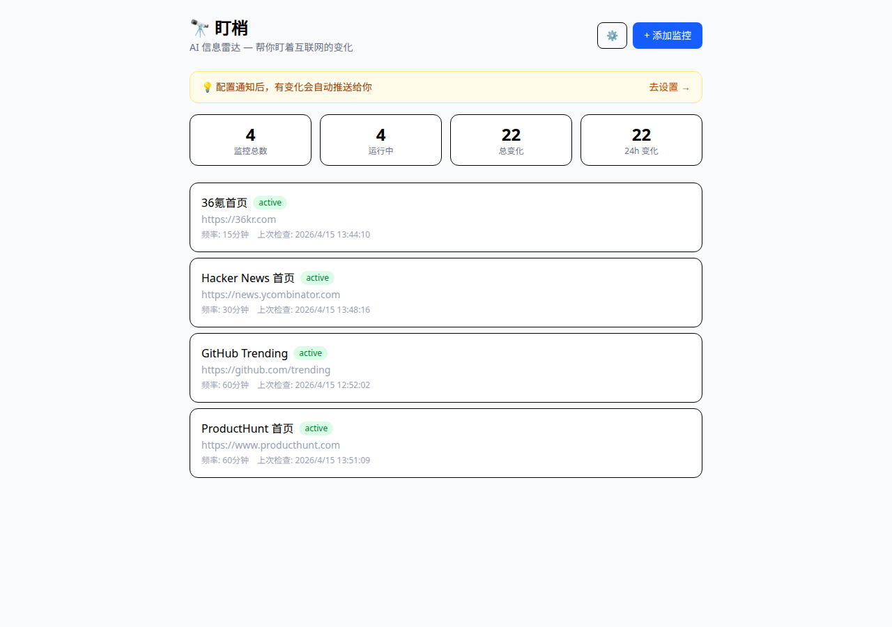
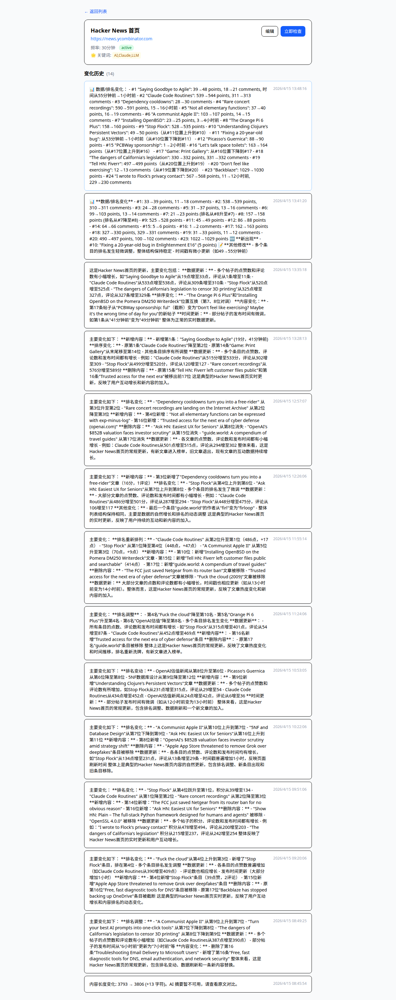
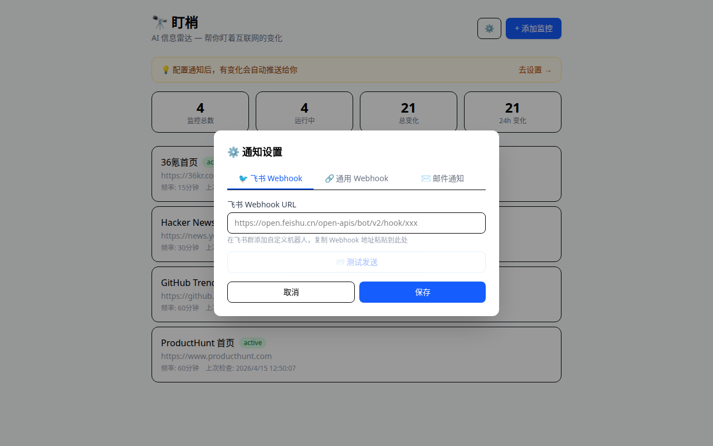

# 🔭 Building DingSao: An AI-Powered Web Change Monitoring Tool

**TL;DR:** I built an open-source web monitoring tool that doesn't just tell you *when* a page changes — it uses AI to tell you *what* changed. Perfect for tracking competitors, job listings, news sites, or any web content you care about.

🔗 **Live Demo:** [Try it here](https://martha-terminal-shows-opinions.trycloudflare.com)  
💻 **GitHub:** [pxivory-max/dingsao](https://github.com/pxivory-max/dingsao)

---

## The Problem: Information Overload

As a developer and indie hacker, I found myself constantly checking multiple websites:
- Hacker News front page for trending tech discussions
- Product Hunt for new launches
- Competitor websites for feature updates
- GitHub Trending for interesting projects
- Job boards for new opportunities

Manually checking these sites was tedious. RSS feeds helped, but many sites don't offer RSS, and even when they do, you get *everything* — not just the changes you care about.

Existing web monitoring tools like Visualping or ChangeTower solve the detection problem, but they dump raw diffs on you. You still need to spend time figuring out what actually matters.

**What I really wanted:** A tool that monitors web pages *and* tells me "here's what changed, and here's why it matters."

---

## The Solution: DingSao (盯梢)

DingSao is an AI-driven web monitoring tool with three core features:

### 1. 🤖 **AI-Powered Change Summaries**

When a page changes, DingSao doesn't just show you a diff. It generates a structured summary:
- **Rankings changed:** Which items moved up or down
- **New content:** What was added
- **Removed content:** What disappeared
- **Data updates:** Numerical changes (votes, comments, prices)

For example, monitoring Hacker News front page, instead of seeing thousands of characters of HTML diff, you get:

```
Ranking Changes:
- "Claude Code" rose from #4 to #2 (515 points, 302 comments)
- "Dependency cooldowns" dropped from #2 to #3

New Entries:
- "Trusted access for AI agents" appeared at #16

Removed:
- "Ask HN: Easiest UX for Seniors" is no longer on front page
```

### 2. 🌐 **JavaScript Rendering Support**

Many modern websites (SPAs, e-commerce sites) are JavaScript-heavy. DingSao uses Playwright under the hood to render these pages properly, so you can monitor:
- Dynamic content (JD.com, Taobao)
- React/Vue/Angular apps
- Sites that lazy-load content

You choose: fast static scraping (for simple pages) or full rendering (for complex ones).

### 3. 🎯 **Precision Monitoring with CSS Selectors**

Don't want to monitor the entire page? Use CSS selectors to target specific sections:
- Monitor only the pricing table on a competitor's page
- Track just the changelog section of a framework's release notes
- Watch only the "Featured" section of a news site

Combine this with **keyword filtering** to get notified only when changes contain terms you care about (e.g., "AI agent", "sale", "hiring").

---

## Technical Implementation

### Stack
- **Backend:** Node.js + Express v5 + SQLite (better-sqlite3)
- **Frontend:** React + Vite + Tailwind CSS v4
- **Scraping:** node-fetch + cheerio (static) / Playwright (dynamic)
- **AI:** Any OpenAI-compatible API (OpenAI, Anthropic, local models)

### Architecture Highlights

**1. Diff Algorithm**
I'm using a character-level diff to capture even small changes, then feeding that to the AI model with a structured prompt:

```javascript
const diff = diffChars(oldContent, newContent);
const prompt = `Analyze this webpage change and provide a structured summary:
- What content was added?
- What content was removed?
- What rankings/numbers changed?
Keep it concise and actionable.`;
```

**2. Smart Change Detection**
Not every change is worth notifying. DingSao filters out:
- Timestamp updates
- Session tokens
- Ad rotations
- Minor formatting changes

Only when *meaningful* content changes do you get a notification.

**3. Multi-Channel Notifications**
Once a change is detected and summarized, DingSao can push notifications via:
- Feishu (Lark) webhooks
- Generic webhooks (Slack, Discord, etc.)
- Email
- *(WeChat push coming soon)*

---

## Real-World Use Cases

### 1. **Competitor Monitoring**
Track your competitors' pricing pages, feature pages, or blog announcements. When they launch something new, you'll know within minutes.

### 2. **Job Hunting**
Monitor your dream company's careers page. Get notified the moment they post a role you're interested in — before it hits LinkedIn or other job boards.

### 3. **Content Aggregation**
Keep tabs on Hacker News, Product Hunt, or Reddit front pages. See what's trending without manually checking multiple times a day.

### 4. **Price Tracking**
Monitor e-commerce sites for price drops or stock availability. Especially useful for limited-edition products or flash sales.

### 5. **Policy & Regulation Tracking**
If you're in a regulated industry, monitor government websites or industry body pages for new announcements or policy changes.

---

## Lessons Learned

### 1. **AI Summaries Are Good, Not Perfect**
In my testing, AI summaries were about 70% accurate. Numerical data (vote counts, comment counts) were precise, but the AI sometimes confused "ranking change" with "new entry." 

I'm working on improving the prompt and potentially adding a post-processing validation layer.

### 2. **Keyword Filtering is Critical**
Early feedback from developer testers: "I don't care about every change; I only want to know when my specific keywords appear."

This feature was initially a "nice-to-have" but quickly became a "must-have." It's now in the current version.

### 3. **Users Want Push, Not Pull**
My initial MVP required users to check the dashboard for changes. Multiple testers said: "If I have to check manually, this is no better than visiting the site myself."

Webhook and email notifications were bumped up the roadmap.

### 4. **Zero Deployment is a Selling Point**
I was initially focused on self-hosting instructions, but several non-technical users said: "I just want to use it; I don't want to deploy Docker containers."

The hosted demo version became surprisingly popular, even though it's behind a Cloudflare Tunnel.

---

## What's Next?

- [ ] User authentication (right now it's single-user)
- [ ] Change importance scoring (not all changes are equally important)
- [ ] WeChat push notifications (huge in China)
- [ ] Mobile app (React Native or Flutter)
- [ ] RSS/API endpoint monitoring (not just HTML pages)
- [ ] Historical trend visualization (see change frequency over time)

---

## Try It Yourself

**Online Demo:**  
Visit [martha-terminal-shows-opinions.trycloudflare.com](https://martha-terminal-shows-opinions.trycloudflare.com) — add a URL you want to monitor, wait 15 minutes, and see the magic happen.

**Self-Hosting:**
```bash
git clone https://github.com/pxivory-max/dingsao.git
cd dingsao
npm install
npx playwright install chromium

# Configure your AI API (OpenAI-compatible)
cp .env.example .env
# Edit .env with your API key

npm start
# Visit http://localhost:18800
```

**Cost to run:** ~$0.01 per change detection (using GPT-4 or Claude Sonnet). For personal use, expect <$5/month.

---

## Feedback & Contributions Welcome!

I'm a solo developer building this as an open-source side project. If you:
- Have a website you want to monitor but DingSao can't scrape it → open an issue
- Want to contribute code → PRs are very welcome
- Have ideas for killer features → I'd love to hear them

**GitHub:** [github.com/pxivory-max/dingsao](https://github.com/pxivory-max/dingsao)

---

## Screenshots

### Dashboard


### AI Change Summary


### Notification Settings


---

*Built with ❤️ by an AI-curious indie hacker. If you found this useful, give it a ⭐ on GitHub!*

---

**Tags:** #webdev #opensource #ai #monitoring #productivity #indiehacker #nodejs #react
